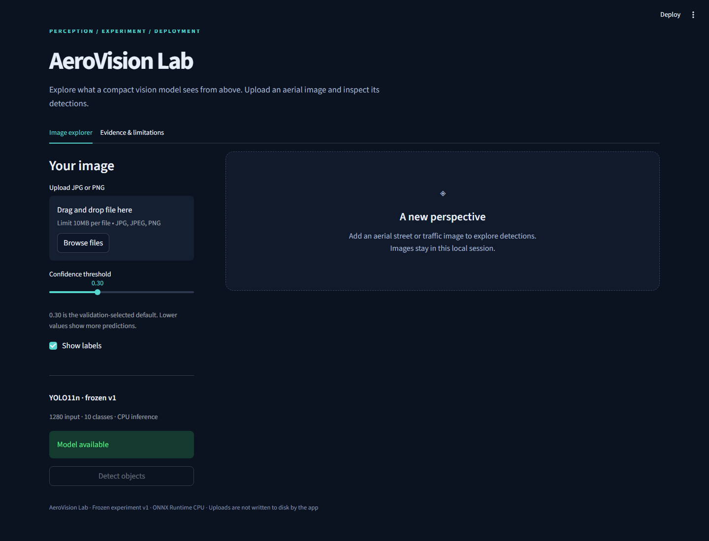
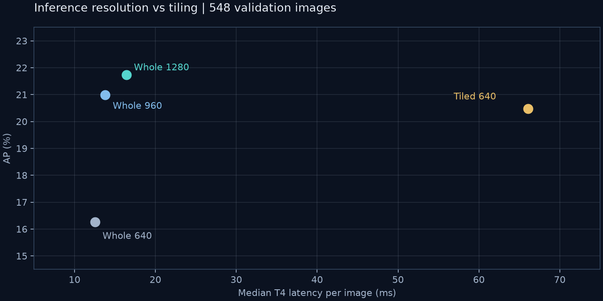

# AeroVision Lab

A compact aerial-object detector with a reproducible experiment trail and a local CPU demo. Built around YOLO11n, VisDrone, and ONNX Runtime.

**Frozen v1:** whole-image inference at 1280, confidence 0.30, class-aware NMS IoU 0.7. On 1,610 held-out test-dev images, increasing inference resolution from 640 to 1280 improved AP from **13.69% to 18.61%** and small-object AP from **4.86% to 11.30%**, using the same trained checkpoint.



The public page combines an interactive results study (resolution, tiling, held-out class AP, training/export workflow) with the live image detector. Charts link to the original experiment records and separate T4 measurements from browser timings.

**[Open the live browser demo](https://www.puneetpal.com/demos/aerovision/index.html)** · [Portfolio project](https://www.puneetpal.com/projects?project=16)

## Try the demo

The demo uses **CPU only** and has no PyTorch or CUDA dependency. It explicitly asks for an aerial/drone JPG/PNG, defaults to confidence **0.55**, draws detections, exposes the confidence threshold, and downloads the annotated image or prediction JSON. Uploads are kept in the local session rather than written to disk.

Use Python 3.12. For a lightweight environment:

```powershell
py -3.12 -m venv .demo-venv
.\.demo-venv\Scripts\python.exe -m pip install -r requirements-demo.txt
python scripts/fetch_model.py
.\.demo-venv\Scripts\python.exe -m streamlit run demo.py
```

The model fetch uses GitHub CLI (`gh`); run `gh auth login` if GitHub requests authentication. It downloads the verified release artifact and checks its SHA-256. Alternatively, extract `aerovision-full-fp32.onnx` from the [model release](https://github.com/puneetpal-singh/aerovision-lab/releases/tag/onnx-fp32-v0.1) into `models/`.

The demo release bundle already includes the model. On Windows, its `Start-Demo.cmd` creates the lightweight environment and starts the app. The app binds to `127.0.0.1`; it is not a hosted public service.

The demo default of 0.55 is for interactive viewing; recorded evaluation metrics still use the validation-selected 0.30 operating point.

CPU timings shown in the app are measurements of the current request. They are separate from the recorded T4 benchmark below.

## Results

All rows below use one frozen checkpoint, the same image set within each table, confidence 0.001 for AP integration, NMS IoU 0.7 and a prediction/evaluator limit of 1000. AP means mean AP across IoU 0.50:0.95. Small-object definitions follow COCO area bins in original image coordinates.

### Inference comparison: all 548 validation images

| Configuration | AP | Small-object AP | Small-object average recall | T4 median latency |
|---|---:|---:|---:|---:|
| Whole image 640 | 16.26% | 7.75% | 13.91% | 12.5 ms |
| Whole image 960 | 20.99% | 13.01% | 23.00% | 13.8 ms |
| Whole image 1280 | **21.73%** | **15.22%** | 28.02% | 16.4 ms |
| Tiled 640, overlap 0.20 | 20.47% | 14.47% | **28.92%** | 66.1 ms |



Whole-image 1280 outperformed the tested tiling configuration in AP and latency. Tiling retained slightly higher small-object average recall. This result applies to this checkpoint, data and tiling setup; it does not establish that tiling is generally ineffective.

### Frozen held-out evaluation: all 1,610 test-dev images

| Metric | Whole 640 baseline | Whole 1280 candidate |
|---|---:|---:|
| AP | 13.69% | **18.61%** |
| AP50 | 24.02% | **32.36%** |
| Small-object AP | 4.86% | **11.30%** |
| Precision at confidence 0.30 | 69.93% | 69.89% |
| Recall at confidence 0.30 | 33.21% | **46.68%** |
| Micro F1 at confidence 0.30 | 45.03% | **55.98%** |
| Median latency | **12.3 ms** | 17.1 ms |

Latency was measured with batch-one PyTorch inference on a T4, with warmup and synchronization. It includes preprocessing, inference, merging and transfer, but excludes image-file decoding. These measurements are not complete application throughput or ONNX CPU benchmarks.

## What was investigated

- **Reproducible data preparation:** seeded subsets, original class mapping, box clipping, image verification, archive/image hashes and exact-duplicate checks across splits.
- **Small-GPU pilots:** 800-image runs established the workflow before full-data training. Changing both batch size and training duration in the second pilot prevents attributing its gain to either factor alone.
- **Full-data baseline:** YOLO11n fine-tuned from COCO weights on 6,471 images for 60 epochs at 640, batch 16, seed 42. Training took about 2 h 44 min on a hosted T4.
- **Tiling and prediction limits:** explicit crop geometry, coordinate mapping and class-aware merging; caps of 300/600/1000 yielded only modest AP changes for the first pilot.
- **Inference resolution:** tested the saved full-data model at 640/960/1280 before committing to another training run.
- **Operating point:** confidence was selected on validation, then fixed for test-dev. Values around 0.25–0.30 had similar aggregate F1; 0.30 favoured precision.
- **Export and deployment:** FP32 ONNX export, numerical checks, independent NumPy postprocessing and a CPU image-upload app.

## Reproduce or inspect

| Purpose | Entry point |
|---|---|
| Small hosted pilot | `notebooks/AeroVision_Colab.ipynb` |
| Pilot detection-limit study | `notebooks/AeroVision_Evaluation.ipynb` |
| Saved-model resolution comparison | `notebooks/AeroVision_Kaggle.ipynb` |
| Frozen held-out evaluation | `notebooks/AeroVision_TestDev.ipynb` |
| Training/data/evaluation CLI | `python -m aerovision.cli --help` |
| Local CPU demo | `python -m streamlit run demo.py` |
| Export verification | `scripts/verify_saved_export.py` |
| Browser demo smoke check | `scripts/smoke_demo.py --image <local-image.jpg>` |

For development, install the appropriate CPU or hosted-CUDA PyTorch build first, then `pip install -e '.[dev,demo,export]'`. Run `pytest` and `ruff check src tests --select E9,F63,F7,F82`. All local GPU training was retired; CLI inference/training defaults to CPU. Training was performed on hosted GPUs.

CI is test-only: CPU tests and lint on relevant code changes to `main` and pull requests. It does not train models, deploy the app, or run for documentation-only pushes and release tags. Notebook source bundles use canonical UTF-8/LF text across Windows/Linux.

The held-out notebook is a record of the frozen experiment. Do not retune on test-dev and continue describing it as untouched. Further development must disclose that these results have been inspected.

## Limitations and interpretation

- Scores use **custom COCO-style evaluation with a crowd approximation for ignored regions**, not the official VisDrone challenge evaluator.
- Ignored/other-object regions are omitted from training targets and can be treated as background by the basic training pipeline.
- Accuracy remains uneven. At confidence 0.30 on test-dev, car recall was 77.4%, pedestrian recall 28.8%, and bicycle recall 4.2%. The demo is a research/portfolio prototype.
- One training seed was evaluated. Statistical confidence intervals and repeat-training variation are not quantified.
- Exact image hashes do not rule out related scenes or near-duplicates.
- ONNX export and demo postprocessing were checked on ten fixed validation images, including 518 detections, plus additional synthetic export shapes. Full test-dev accuracy was measured with PyTorch, not this demo.
- The model was trained on aerial imagery; performance on ground-level, industrial or unfamiliar images has not been established.

Details: [model card](docs/model-card.md), [case study](docs/portfolio-case-study.md), [held-out review](docs/testdev-review.md), [confidence review](docs/confidence-review.md), [export verification](docs/export-verification.md), [demo runtime check](docs/demo-runtime-verification.json).

## Source attribution

The experiment pipeline, data conversion, tiling logic, diagnostics, packaging and NumPy/ONNX demo runtime were implemented for this project. The neural network architecture, pretrained weights and training engine come from [Ultralytics YOLO](https://github.com/ultralytics/ultralytics). The dataset comes from the [VisDrone team](https://github.com/VisDrone/VisDrone-Dataset), via its Ultralytics assets mirror. Inference uses [ONNX Runtime](https://onnxruntime.ai/) and the local UI uses [Streamlit](https://streamlit.io/).

Dataset images and model binaries are not committed to Git. Model artifacts live in GitHub releases. Upstream software, model and dataset terms apply to their respective components.

## Browser deployment

`web-demo/` contains the public static demo. It uses a dedicated CPU WebAssembly worker, client-side image processing, confidence 0.55 by default, class-aware NMS and image/JSON downloads. The original frozen metrics remain unchanged. To prepare a portfolio checkout, install `onnxruntime-web@1.22.0` there, install the verified local model here, then run `python scripts/prepare_portfolio.py <portfolio-checkout>`. Serve its public directory or deploy the portfolio. The browser uses Canvas resampling; full-set browser accuracy has not been measured. See the model card for the scope of export verification.

Source/model distribution: AGPL-3.0. ONNX Runtime Web: MIT, retained alongside its vendored assets.
